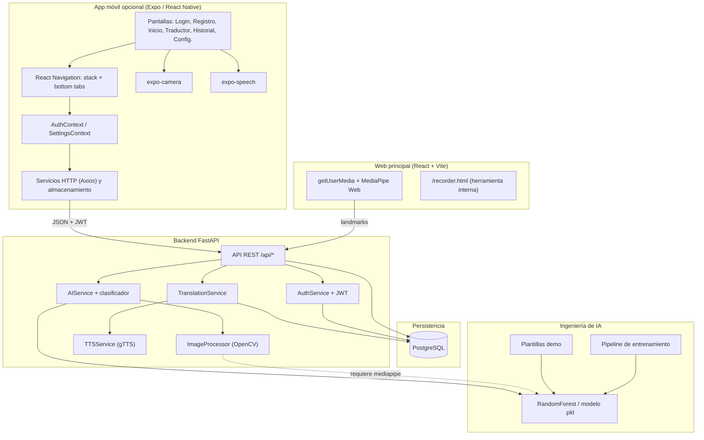
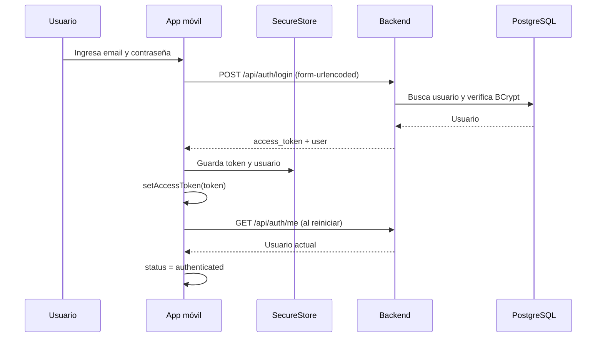
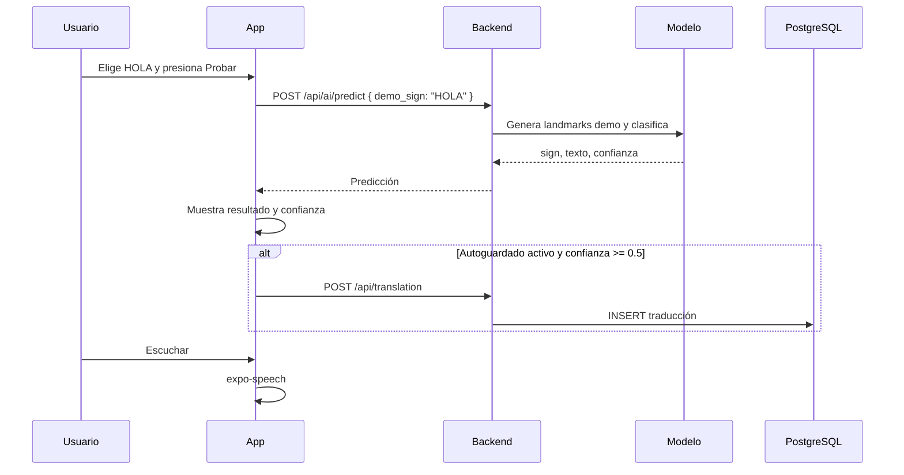
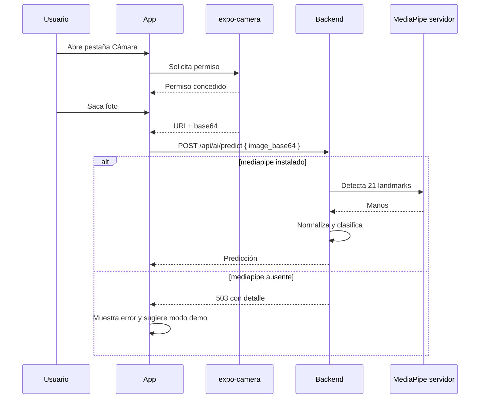

# Arquitectura del sistema

> Documento de arquitectura general, decisiones de diseño y flujo completo.
> Última actualización: **2026-11-13**. El cliente principal es la **web**; la
> app móvil se documenta como cliente opcional.

---

## 1. Visión general

El sistema traduce Lengua de Señas Argentina (LSA) a texto y voz. El cliente
principal es la **aplicación web (React + Vite)**, que ejecuta MediaPipe en el
navegador y funciona en computadora y celular. El backend es una **API REST
FastAPI** con persistencia PostgreSQL o SQLite. La app **Expo/React Native** se
conserva como cliente opcional y experimental.

```text
Cámara (navegador) o seña demo
      |
      v
Web: MediaPipe extrae 21 landmarks por mano
      |
      | JSON + JWT
      v
Backend FastAPI: valida, normaliza y clasifica
      |
      +--> Modelo IA (demo o entrenado)
      +--> PostgreSQL / SQLite: usuarios, historial, catálogo
      |
      v
Respuesta: sign + translated_text + confidence
      |
      +--> Panel de resultado
      +--> Web Speech API (voz del navegador)
      +--> Historial (POST /api/translation)
```

### Alcance real

- El modelo incluido es de **demostración**: 9 clases construidas con plantillas
  sintéticas. Sirve para validar el flujo completo, no para reconocer LSA real.
- La web detecta manos en el navegador y manda landmarks: es el único camino de
  reconocimiento en tiempo real que funciona hoy.
- La app móvil captura **una foto** y la envía al backend; necesita `mediapipe`
  del lado servidor, que no está instalado por defecto.
- El catálogo tiene 86 señas y el modelo demo reconoce 9; `/api/signs` marca
  cada seña con `recognized` para que la UI muestre cuáles están pendientes.

---

## 2. Componentes



### Responsabilidades

| Componente | Responsabilidad |
|---|---|
| Web (principal) | Autenticación, captura con MediaPipe, visualización, voz, historial y preferencias |
| App móvil (opcional) | Autenticación, captura de foto, visualización, voz, historial y preferencias |
| Backend | Validación, autenticación, clasificación, persistencia y TTS alternativo |
| Modelo IA | Convertir 63 features de una mano en una clase con probabilidad |
| PostgreSQL / SQLite | Usuarios, traducciones y catálogo de señas |
| Pipeline `ai/` | Captura, normalización, aumentación y entrenamiento de modelos |

---

## 3. Tecnologías

| Capa | Tecnología | Versión observada | Motivo |
|---|---|---|---|
| Web (principal) | React + Vite | 18 / 6 | Cliente único para computadora y celular |
| Web (principal) | MediaPipe Tasks Vision | 0.10 | Detección de manos en el navegador |
| Web (principal) | React Router | 6 | Rutas públicas y página interna del grabador |
| App móvil (opcional) | Expo | SDK 58 | Flujo de desarrollo simple, módulos de cámara, voz y almacenamiento seguro |
| App móvil (opcional) | React Native | 0.88 | Cliente nativo Android/iOS con un solo código |
| App móvil (opcional) | React | 19.3 | Componentes y hooks |
| App móvil (opcional) | TypeScript | 6.0 | Tipado estricto del contrato de API |
| Navegación | React Navigation | 7 | Stack de autenticación + tabs principales |
| HTTP | Axios | 1.20 | Interceptores de JWT y normalización de errores |
| Cámara | expo-camera | SDK 58 | Permisos y captura de fotos |
| Voz | expo-speech | SDK 58 | TTS nativo sin depender de internet |
| Almacenamiento seguro | expo-secure-store | SDK 58 | JWT fuera de AsyncStorage en Android/iOS |
| Preferencias | AsyncStorage | 2.2 | Tema, idioma, velocidad y autoguardado |
| Backend | FastAPI + Uvicorn | 0.115+ | API tipada, validación y Swagger automático |
| Backend | Pydantic | 2.8+ | Esquemas y validación |
| Persistencia | SQLAlchemy 2 | 2.0+ | ORM portable (PostgreSQL/SQLite) |
| Base de datos | PostgreSQL | 14+ | Relacional, con índices y restricciones |
| Seguridad | BCrypt + python-jose | — | Hash de contraseñas y JWT HS256 |
| IA | scikit-learn RandomForest | 1.4+ | Rápido en CPU, probabilidades por clase |
| Imagen (opcional) | OpenCV headless | 4.8+ | Solo para la ruta `image_base64` |
| TTS alternativo | gTTS | 2.5+ | Audio MP3 en el backend |
| Pruebas backend | pytest + httpx | 8.0+ | Integración con `TestClient` |
| Pruebas web | Vitest + Testing Library | 2.1 / 16 | 19 pruebas + build |
| Pruebas móvil | Jest + jest-expo + RNTL | 30 / 14 | Unidades y componentes (opcional) |

---

## 4. Flujo de la app móvil (opcional)

### 4.1 Autenticación y sesión



- Al arrancar, `AuthContext` lee el token de SecureStore.
- Si hay red, valida con `/api/auth/me`.
- Si no hay red pero existe un usuario guardado, conserva la sesión.
- Si `/api/auth/me` responde `401`, cierra la sesión.
- Cualquier respuesta `401` posterior dispara el cierre de sesión global.

### 4.2 Traducción por demostración



### 4.3 Traducción por cámara



La foto no se persiste: se usa en memoria para extraer landmarks y se descarta.
El backend tampoco guarda la imagen en la base de datos.

---

## 5. Contrato de datos con el modelo

Por cada mano, MediaPipe entrega **21 landmarks** con coordenadas `(x, y, z)`.
El backend:

1. Valida que cada mano tenga forma `(21, 3)` y valores finitos.
2. Elige la mano más prominente si hay varias.
3. Centra la mano en la muñeca y escala por el máximo valor absoluto.
4. Aplana la matriz a **63 features**.
5. Clasifica con el modelo activo y devuelve la clase con mayor probabilidad.

```text
21 landmarks × 3 coordenadas = 63 features
```

El contrato es estable aunque cambie el algoritmo de clasificación. La
documentación anterior mencionaba “63–126” de forma ambigua; el código actual
**clasifica una sola mano**.

Limitaciones de la normalización:

- Invariancia a traslación y escala.
- **No** invariancia a rotación.
- La cámara frontal puede reflejar la imagen; esto puede afectar la geometría
  de la mano y, por lo tanto, la predicción. Conviene probar cámara frontal y
  trasera con un modelo entrenado real.

---

## 6. Estructura de la app móvil (opcional)

```text
mobile/
├── App.tsx                     Providers y navegación raíz
├── index.ts                    Registro de Expo
├── app.json                    Permisos, plugins e identificadores
├── src/
│   ├── components/             AppButton, Card, Screen, TextField, etc.
│   ├── constants/
│   │   ├── config.ts           URL, umbrales, claves y opciones
│   │   ├── signs.ts            Vocabulario local de respaldo
│   │   └── theme.ts            Colores, spacing y tipografía
│   ├── context/
│   │   ├── AuthContext.tsx     Sesión, login, registro, logout
│   │   └── SettingsContext.tsx Preferencias persistentes
│   ├── hooks/                  useAuth, useTheme, useSpeech, etc.
│   ├── navigation/             AppNavigator, AuthNavigator, MainTabs
│   ├── screens/
│   │   ├── auth/               Login, Registro
│   │   └── main/               Inicio, Traductor, Historial, Configuración
│   ├── services/
│   │   ├── http.ts             Axios + interceptores
│   │   ├── auth.ts             Registro, login, me
│   │   ├── ai.ts               Predicción, info, catálogo
│   │   ├── translations.ts     Historial
│   │   └── storage.ts          SecureStore con fallback web
│   ├── types/                  Contratos de API y navegación
│   └── utils/                  Validación, errores y formato
└── tests/                      Jest + RNTL
```

### Estado y navegación

- `AuthContext` define `loading`, `authenticated` o `anonymous`.
- `AppNavigator` muestra un splash mientras se verifica la sesión, luego el
  stack de autenticación o las tabs principales.
- `SettingsContext` carga preferencias al inicio y las persiste en AsyncStorage.
- `useTranslationHistory` encapsula carga, refresco y eliminación.

---

## 7. Backend

```text
backend/app/
├── api/
│   ├── deps.py                 Usuario autenticado
│   ├── router.py               Agrupación de rutas
│   └── routes/                 auth, ai, health/signs, translations
├── ai/                         landmarks, plantillas, clasificador, traducciones
├── core/                       settings y seguridad
├── database/                   Base, engine y sesión
├── models/                     SQLAlchemy
├── schemas/                    Pydantic
├── services/                   auth, ai, translation, tts, image
└── main.py                     App, CORS, lifespan
```

### Rutas

| Prefijo | Responsabilidad |
|---|---|
| `/api/auth` | Registro, login y usuario actual |
| `/api/ai` | Predicción e información del modelo |
| `/api/translation` | CRUD del historial y audio |
| `/api` | Salud y catálogo de señas |

### Inicialización

- `lifespan` ejecuta `Base.metadata.create_all(bind=engine)`.
- El clasificador se carga de forma perezosa en la primera predicción o en
  `/api/health`.
- Si no existe un modelo entrenado, entrena el demo y lo guarda en
  `backend/app/ai/models/demo_sign_model.pkl`.

En producción se recomienda aplicar `database/schema.sql` y usar migraciones
(Alembic) en lugar de `create_all`.

---

## 8. Decisiones de arquitectura

| Decisión | Justificación | Costo |
|---|---|---|
| **Web como cliente principal** | Un solo código que corre en computadora y celular; MediaPipe funciona en el navegador y el reconocimiento es en tiempo real | Depende del soporte de cámara/WebAssembly del navegador |
| **App móvil opcional con Expo** | Se conserva el trabajo de React Native y sirve si se necesita publicar en stores | Duplica mantenimiento y hoy no reconoce señas sin `mediapipe` server-side |
| **No portar MediaPipe web a React Native** | `@mediapipe/tasks-vision` depende de WebAssembly/WebGL y del DOM; no funciona directamente en RN | La app móvil no tiene detección en vivo |
| **Captura de foto + `image_base64`** | Camino acotado: una imagen por gesto, sin streaming; reutiliza el backend existente | Requiere `mediapipe` server-side; mayor latencia y payload |
| **Modo demo** | Permite probar todo el flujo sin cámara ni dataset | No demuestra precisión real |
| **Modelo en el backend** | Se puede reemplazar por un `.pkl` entrenado sin actualizar el cliente; centraliza la lógica | Dependencia de red para traducir |
| **JWT en SecureStore / localStorage** | En móvil evita almacenamiento plano; en web es simple para un proyecto académico | En web es vulnerable a XSS |
| **Herramienta de grabación separada** | El usuario final no ve la captura; se sirve como entrada propia sin navbar | Hay que protegerla por rol (`ADMIN_EMAILS`) |
| **Servicios separados y hooks** | Facilita pruebas y mantiene las pantallas enfocadas en UI | Más archivos y algo de indirección |
| **Tema con tokens** | Claro/oscuro consistente y sin CSS global | Requiere usar `useTheme` en cada componente |
| **Corregir `/api/signs` con `SignOut`** | Evita el `500` cuando la base no está sembrada | El fallback usa `id=0` para todas las señas |

### ¿Por qué no se usa el modelo en el dispositivo?

- El modelo actual es un `.pkl` de scikit-learn, no un formato móvil.
- Ejecutar scikit-learn en RN requeriría un puente nativo o convertir el modelo
  a TensorFlow Lite/ONNX.
- El objetivo de esta etapa es conservar el backend y validar el flujo completo,
  no optimizar inferencia offline.

Alternativas futuras, en orden de esfuerzo:

1. **WebView** con MediaPipe web (reutiliza el cliente actual, pero pierde
   experiencia nativa).
2. **VisionCamera + módulo nativo** de MediaPipe (mejor rendimiento, más
   complejidad de build).
3. **Modelo TFLite** en el dispositivo (requiere convertir y validar el modelo).

---

## 9. Seguridad y privacidad

- Contraseñas con BCrypt; nunca se devuelven ni se registran.
- JWT HS256 con expiración configurable.
- Validación de cuerpos con Pydantic y de formularios en la app.
- El token se guarda en SecureStore en Android/iOS.
- La app no solicita permiso de micrófono; `recordAudioAndroid: false`.
- La foto se envía al backend y no se guarda en el dispositivo ni en la base.
- CORS solo aplica al cliente web; las apps nativas no están sujetas a CORS.
- En producción: HTTPS obligatorio, `SECRET_KEY` fuerte, CORS restringido y
  rotación de tokens si se agrega refresh.

---

## 10. Despliegue

### Desarrollo

```text
Teléfono/emulador --HTTP--> Backend local (8000) --SQLAlchemy--> PostgreSQL/SQLite
```

- `EXPO_PUBLIC_API_URL` debe apuntar a la IP alcanzable desde el dispositivo.
- En emulador Android, `10.0.2.2` representa la máquina anfitriona.
- El backend debe escuchar en `0.0.0.0` si se prueba desde un teléfono físico:
  `uvicorn app.main:app --host 0.0.0.0 --port 8000`.

### Producción

```text
App publicada --HTTPS--> API detrás de proxy --PostgreSQL gestionado
```

- Compilar con EAS Build o un development build.
- No usar HTTP sin TLS en Android/iOS.
- Cambiar `SECRET_KEY`, sembrar la base y aplicar migraciones.
- Configurar `AI_MODEL_PATH` con un modelo validado.
- Monitorear latencia, tasa de error y uso de la ruta de imagen.

---

## 11. Riesgos y límites actuales

| Riesgo | Impacto | Estado |
|---|---|---|
| Modelo demo sin LSA real | Predicciones no representativas | Documentado; requiere dataset |
| `mediapipe` ausente en backend | La cámara móvil devuelve `503` | Documentado; modo demo disponible |
| Cámara no probada en dispositivo | Puede fallar permiso, orientación o mirror | Pendiente de verificación física |
| CORS y red local | Un teléfono no alcanza `localhost` | Se usa IP LAN o `10.0.2.2` |
| Token expirado | Cierre de sesión inesperado | Manejado con interceptor 401 |
| Sin migraciones | Cambios de esquema manuales | Usar `schema.sql`/Alembic a futuro |
| Sin refresh token | El usuario debe volver a iniciar sesión cada 60 min | Aceptado para el alcance actual |
| `AI_MODEL_MODE` ignorado | Configuración engañosa | Documentado; corregir si se necesita |
| `AI_MIN_CONFIDENCE` no aplicado en backend | El servidor devuelve clases de baja confianza | La app filtra al guardar/advertir |

---

## 12. Documentos relacionados

- [Índice de documentación](README.md)
- [API REST](api.md)
- [Base de datos](database.md)
- [Instalación y ejecución](instalacion-y-ejecucion.md)
- [Pruebas y errores](pruebas-y-errores.md)
- [Cómo agregar señas](como-agregar-mas-senas.md)
- [Análisis de limpieza y mejoras](analisis-limpieza-y-mejoras.md)

Los documentos históricos están en [`archivo/`](archivo/).
