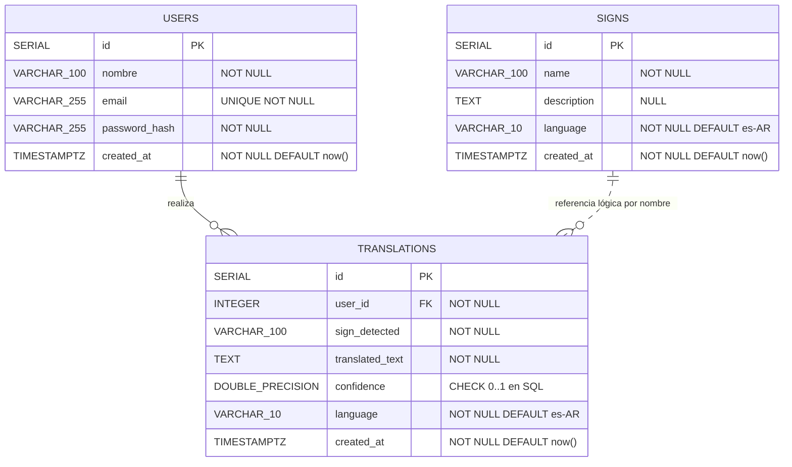

# Modelo de datos

> Base PostgreSQL del Traductor de Lenguaje de Señas.
> DDL completo: [`database/schema.sql`](../database/schema.sql)
> Datos iniciales: [`database/seed.sql`](../database/seed.sql)

---

## 1. Modelo entidad-relación



### Relaciones reales

| Relación | Tipo | Implementación |
|---|---|---|
| `translations.user_id → users.id` | 1 usuario : N traducciones | Foreign key con `ON DELETE CASCADE` |
| `translations.sign_detected → signs.name` | Lógica, no FK | El historial guarda el nombre; no hay foreign key |

La última relación es **deliberadamente lógica**: si se elimina o renombra una
seña del catálogo, el historial conserva el texto que se registró. No se puede
garantizar integridad referencial por nombre entre `translations` y `signs`
porque el catálogo es multiidioma y la clave real es `(name, language)`.

---

## 2. Tablas

### `users`

| Columna | Tipo | Restricciones |
|---|---|---|
| `id` | `SERIAL` | PK |
| `nombre` | `VARCHAR(100)` | NOT NULL |
| `email` | `VARCHAR(255)` | NOT NULL, UNIQUE |
| `password_hash` | `VARCHAR(255)` | NOT NULL; BCrypt |
| `created_at` | `TIMESTAMPTZ` | NOT NULL, `NOW()` |

En `schema.sql` existe además `users_email_format`, un `CHECK` con expresión
regular para el formato del email. La validación principal ocurre en Pydantic.

### `signs`

| Columna | Tipo | Restricciones |
|---|---|---|
| `id` | `SERIAL` | PK |
| `name` | `VARCHAR(100)` | NOT NULL |
| `description` | `TEXT` | NULL |
| `language` | `VARCHAR(10)` | NOT NULL, default `es-AR` |
| `created_at` | `TIMESTAMPTZ` | NOT NULL, `NOW()` |

Restricción: `UNIQUE (name, language)`. La misma seña puede existir en varios
idiomas.

### `translations`

| Columna | Tipo | Restricciones |
|---|---|---|
| `id` | `SERIAL` | PK |
| `user_id` | `INTEGER` | NOT NULL, FK a `users.id`, `ON DELETE CASCADE` |
| `sign_detected` | `VARCHAR(100)` | NOT NULL |
| `translated_text` | `TEXT` | NOT NULL |
| `confidence` | `DOUBLE PRECISION` | NOT NULL, default `0.0`; `CHECK 0..1` en SQL |
| `language` | `VARCHAR(10)` | NOT NULL, default `es-AR` |
| `created_at` | `TIMESTAMPTZ` | NOT NULL, `NOW()` |

La API guarda `sign_detected` en mayúsculas y valida `confidence` con Pydantic.
La restricción `CHECK` existe en PostgreSQL, pero **no** en los modelos
SQLAlchemy; por eso `create_all` en SQLite no la crea.

---

## 3. Índices

| Índice | Tabla | Uso |
|---|---|---|
| `idx_users_email` | `users` | Búsqueda por email en login |
| `idx_translations_user_date` | `translations (user_id, created_at DESC)` | Historial por usuario |
| `idx_translations_language` | `translations (language)` | Filtro por idioma |
| `idx_signs_language` | `signs (language)` | Catálogo por idioma |
| `idx_signdetected_name` | `translations (sign_detected)` | Consultas por seña |

SQLAlchemy también declara índices en `users.email`, `translations.user_id`,
`translations.language`, `translations.sign_detected` y `signs.language`.

---

## 4. Normalización

El esquema está en **tercera forma normal (3FN)**:

| Forma | Verificación |
|---|---|
| 1FN | Atributos atómicos: nombre, email, texto traducido y confianza separados |
| 2FN | Claves primarias simples; no hay dependencias parciales |
| 3FN | El catálogo no repite datos del usuario ni de la traducción |

Decisión de diseño: el historial guarda el **nombre** de la seña y no un `sign_id`.
Esto hace el historial legible y estable ante cambios del catálogo. El costo es
que no hay FK y que el nombre puede quedar desactualizado si se renombra una
seña.

---

## 5. Creación de la base

### Opción A: PostgreSQL con SQL

```powershell
psql -U postgres -c "CREATE DATABASE sign_language;"
psql -U postgres -d sign_language -f database\schema.sql
psql -U postgres -d sign_language -f database\seed.sql
```

`schema.sql` usa `CREATE TABLE IF NOT EXISTS` y `seed.sql` usa
`ON CONFLICT (name, language) DO NOTHING`, por lo que se puede volver a ejecutar
sin duplicar las señas demo.

### Opción B: desarrollo con `create_all`

Al iniciar el backend, `lifespan` ejecuta:

```python
Base.metadata.create_all(bind=engine)
```

Esto crea las tablas si no existen, pero **no aplica** los `CHECK` ni los
comentarios definidos solo en `schema.sql`. Es cómodo para desarrollo y pruebas.

### Opción C: SQLite para pruebas

```powershell
$env:DATABASE_URL = "sqlite:///./sl_translator.db"
uvicorn app.main:app --reload --port 8000
```

Las pruebas de pytest usan `sqlite:///./test_sl.db` y no requieren PostgreSQL.

### Docker

`docker-compose.yml` monta `schema.sql` y `seed.sql` como scripts de
inicialización de PostgreSQL. No se verificó en este entorno porque Docker no
está instalado.

---

## 6. Datos iniciales

`seed.sql` inserta **86 señas** del catálogo en `es-AR`. Las primeras 9
coinciden con el vocabulario del modelo demo:

| `name` | `description` | `language` |
|---|---|---|
| `HOLA` | Saludo estándar. | `es-AR` |
| `GRACIAS` | Expresión de agradecimiento. | `es-AR` |
| `SI` | Afirmación. | `es-AR` |
| `NO` | Negación. | `es-AR` |
| `ADIOS` | Despedida. | `es-AR` |
| `POR_FAVOR` | Pedido cortés. | `es-AR` |
| `BUENOS_DIAS` | Saludo al comenzar el día. | `es-AR` |
| `BUENAS_TARDES` | Saludo por la tarde. | `es-AR` |
| `AYUDA` | Pedido de asistencia o ayuda. | `es-AR` |

El resto son señas del catálogo que el modelo demo todavía no reconoce. Por eso
`GET /api/signs` devuelve `recognized: false` para ellas.

Si la base está vacía, `GET /api/signs` devuelve igualmente las 9 señas demo
desde `DEMO_SIGNS`, con `id=0`, `description=null` y `created_at` actual. Ese
fallback no inserta filas.

---

## 7. Migraciones y evolución

- No hay Alembic ni otro sistema de migraciones.
- En desarrollo se usa `create_all`; en producción, `schema.sql`.
- Un cambio de esquema requiere:
  1. actualizar modelos SQLAlchemy,
  2. actualizar `schema.sql`,
  3. preparar un script de migración manual o introducir Alembic.
- Para agregar campos nuevos (por ejemplo `status` en `signs`) hay que actualizar
  modelos, `schema.sql` y preparar una migración manual o introducir Alembic.

---

## 8. Consultas típicas

```sql
-- Historial reciente de un usuario
SELECT id, sign_detected, translated_text, confidence, created_at
FROM translations
WHERE user_id = 1
ORDER BY created_at DESC, id DESC
LIMIT 50;

-- Conteo por seña
SELECT sign_detected, COUNT(*) AS total
FROM translations
WHERE user_id = 1
GROUP BY sign_detected
ORDER BY total DESC;

-- Catálogo por idioma
SELECT id, name, description
FROM signs
WHERE language = 'es-AR'
ORDER BY name;
```

---

## 9. Respaldo y seguridad

- No se guardan imágenes ni videos en la base.
- `password_hash` nunca debe exponerse en consultas de reporting.
- El respaldo debe incluir `users`, `translations` y `signs`.
- En producción, usar un usuario de base con permisos mínimos y conexión TLS.
- `DATABASE_URL` contiene credenciales: no debe commitearse.
